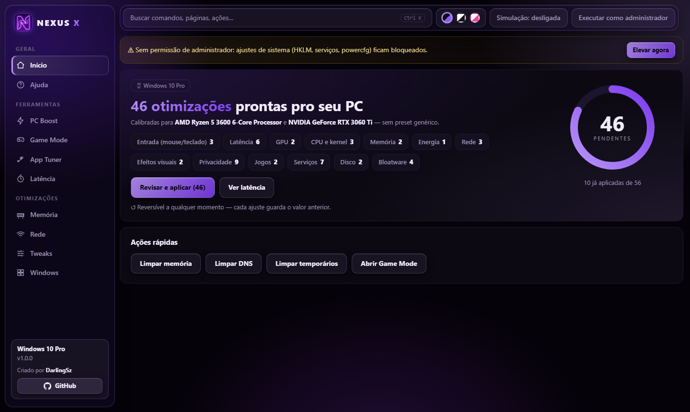
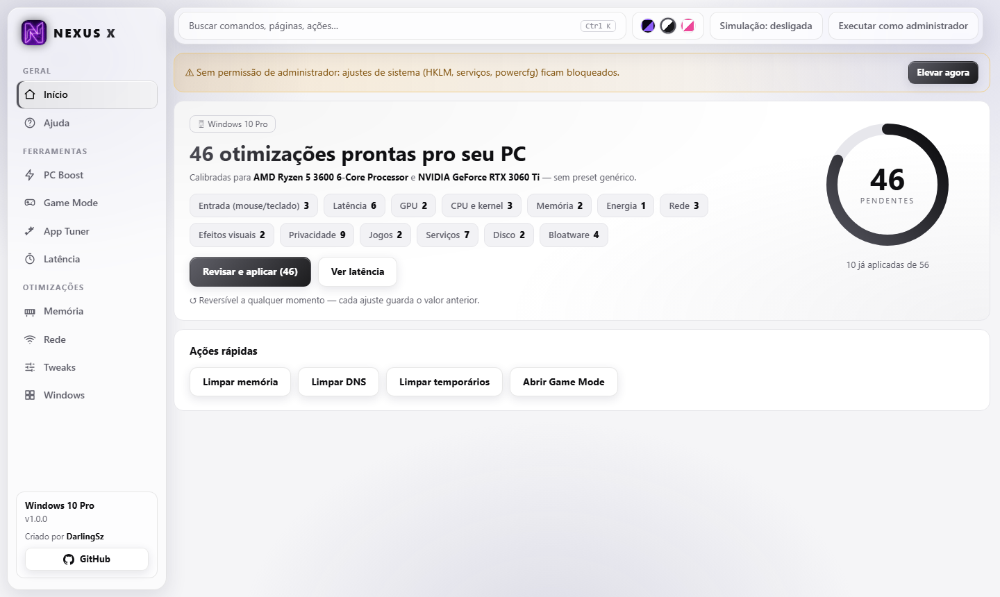
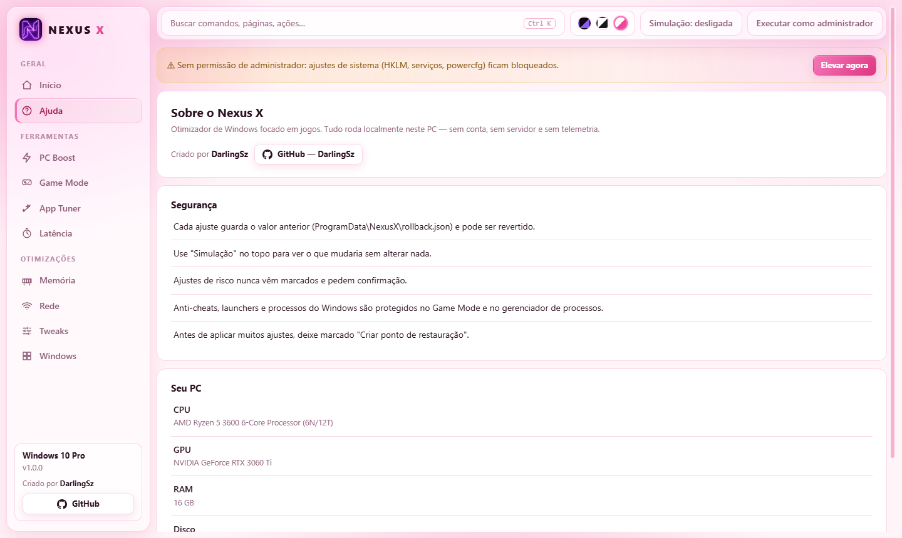

<p align="center">
  
</p>

<h1 align="center">Nexus X</h1>

<p align="center">
  Otimizador de Windows para jogos.<br>
  Roda 100% no seu PC — sem conta, sem servidor, sem telemetria.
</p>

<p align="center">
  <a href="https://github.com/DarlingSz/Nexus-X/releases/latest/download/NexusX.exe"><b>⬇ Baixar o Nexus X (NexusX.exe, ~75 MB)</b></a><br>
  <a href="https://github.com/DarlingSz/Nexus-X/releases/latest">Notas da versão e checksum</a>
</p>

<p align="center">
  
</p>

## Como usar

1. Baixe o **NexusX.exe** (link acima) e salve em qualquer pasta.
2. Dê dois cliques. É um arquivo único: não instala nada e não precisa do .NET.
3. Veja as recomendações para o seu PC. Ligue **Simulação** no topo para ver exatamente o que mudaria **sem alterar nada**.
4. Para os ajustes de sistema, use o botão **Executar como administrador** dentro do app.

## Aviso do Windows e de antivírus

O executável **não é assinado digitalmente**. Por isso, na primeira vez o Windows SmartScreen pode mostrar *"O Windows protegeu o computador"*: clique em **Mais informações → Executar assim mesmo**.

Alguns antivírus desconfiam de qualquer otimizador que altera o registro e serviços. Se isso acontecer, confira o arquivo pelo checksum (abaixo) e decida se quer usá-lo.

## O que ele faz

- **78 ajustes reversíveis** (latência, GPU, CPU, rede, memória, privacidade, serviços, visual). Cada um guarda o valor anterior antes de mudar, e o botão de reverter devolve exatamente o original.
- **Recomendações pelo seu hardware**: lê CPU, GPU, RAM, tipo de disco, se é notebook (e se está na bateria) e a versão do Windows, e sugere, pula ou marca como arriscado cada ajuste. Ajustes de risco nunca vêm marcados.
- **Game Mode** com 4 perfis (Balanceado, Competitivo, Extremo, Streaming), 17 ações que se desfazem sozinhas ao fechar o jogo e um motor adaptativo que rebaixa apps que sufocam o jogo (nunca toca em anti-cheats, launchers nem no Windows).
- **App Tuner**: Discord, Steam, Battle.net, OBS, Chrome, Edge, Brave, Epic, EA App, Ubisoft Connect, Spotify, WhatsApp, NVIDIA 3D Settings e AMD (ULPS), sempre com backup e reversão.
- **Memória e Rede**: liberar memória, limpar temporários, gerenciador de processos, troca de DNS com restauração exata, teste de latência.
- **Apps de inicialização**, **Latência** e **Windows** (privacidade e bloatware).
- **3 temas**: Midnight (preto e roxo), All White e Pink & White — com vidro nas barras e nos botões.

<p align="center">
  
  
</p>

## Segurança e reversão

- O que cada ajuste mudou fica registrado em `C:\ProgramData\NexusX\rollback.json`; os backups do App Tuner ficam em `%LOCALAPPDATA%\NexusX\apptuner`.
- Antes de aplicar vários ajustes, deixe marcado **"Criar ponto de restauração"**.
- A interface conversa com um motor local que só aceita conexões do próprio PC (`127.0.0.1`) e exige um token que muda a cada abertura.
- O **único** link externo do app abre o perfil do criador no navegador.

## Requisitos

- Windows 10 (22H2) ou Windows 11, 64 bits.
- WebView2 Runtime (já vem no Windows 11 e na maioria dos Windows 10). Sem ele, o app abre numa janela do Edge ou Chrome.
- Alguns ajustes exigem administrador.

> Testado no Windows 10 Pro 22H2. Em outras versões e hardwares, comece pelo modo **Simulação**.

## Verificar o arquivo

Cada Release traz o `SHA256SUMS.txt`. No PowerShell:

```powershell
Get-FileHash .\NexusX.exe -Algorithm SHA256
```

O valor precisa ser igual ao do `SHA256SUMS.txt` da versão que você baixou.

## Desinstalar

1. Dentro do app, reverta os ajustes que você aplicou.
2. Apague o `NexusX.exe`.
3. Opcional: apague `C:\ProgramData\NexusX` e `%LOCALAPPDATA%\NexusX`.

## Limitações conhecidas

- O tuner **AMD** só desliga o ULPS e **não foi testado em placa AMD**; o Radeon Super Resolution não está incluído.
- **Pausar o Windows Update** é melhor esforço: o Windows pode reiniciar os serviços sozinho.
- O Game Mode mostra CPU e RAM, sem contador de FPS. Fixar o jogo nos núcleos de um Intel híbrido ainda não existe.

## Criador

Criado por **[DarlingSz](https://github.com/DarlingSz)**.

## Aviso

Fornecido **como está, sem garantia**. Alterar configurações do sistema envolve risco: use por sua conta, comece pela Simulação e crie um ponto de restauração. Microsoft, Windows, NVIDIA, AMD, Intel, Discord, Steam e os demais nomes citados pertencem aos seus donos; o Nexus X não é afiliado a eles.
